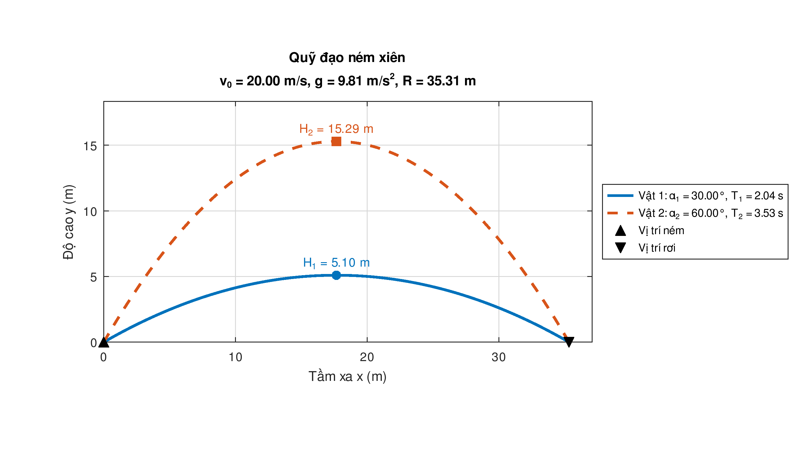

# BTL Vật lý 1 – Bài 6: Quỹ đạo chuyển động ném xiên

Mã nguồn MATLAB cho bài tập lớn Vật lý 1 (HK1, 2026–2027).

**Đề bài.** Hai vật được ném lên từ mặt đất với cùng vận tốc ban đầu `v0`. Coi trọng trường là đều và bỏ qua sức cản không khí. Với góc ném `α1` nhập vào ở mỗi lần chạy, tìm góc ném `α2` để hai vật có cùng tầm ném xa, sau đó vẽ quỹ đạo của hai vật.

**Cơ sở.** Tầm xa `R = v0²·sin(2α)/g`, nên điều kiện `R1 = R2` tương đương `sin(2α1) = sin(2α2)`. Phương trình này có hai họ nghiệm `α2 = α1 + kπ` và `α2 = π/2 − α1 + kπ` (k nguyên). Trong miền vật lý `0° < α < 90°` chỉ còn `α2 = 90° − α1`, trùng với `α1` khi `α1 = 45°`.



*Hình mẫu với v0 = 20 m/s, α1 = 30°, g = 9,81 m/s² (kết xuất bằng GNU Octave; hình dùng trong báo cáo nên xuất lại từ MATLAB).*

## Cấu trúc thư mục

```
btl-vl1-bai6/
├── README.md
├── .gitignore
├── .gitattributes
├── src/                      Chương trình chính (chạy được độc lập)
│   ├── main.m
│   ├── inputParameters.m
│   ├── solveAngleSymbolic.m
│   ├── calculateProjectile.m
│   ├── plotTrajectories.m
│   ├── runTests.m
│   └── chaythudoclap_solveAngleSymbolic.m
├── app/                      Giao diện App Designer (mở app/VL1_1.m)
│   ├── VL1_1.m
│   ├── VL1_1.xml             Bố cục giao diện, phải nằm cùng thư mục với VL1_1.m
│   └── _ban_cu/              Bản cũ VL1.m + VL1.xml (không dùng nữa)
└── figures/                  Hình quỹ đạo do main.m lưu ra
    └── quydao_v0_20_alpha1_30.png
```

## Các module

| File | Phụ trách | Chức năng |
| --- | --- | --- |
| `main.m` | Tích hợp | Chương trình chính: nhập liệu → giải Symbolic → tính thông số → kiểm chứng → vẽ và lưu hình. |
| `inputParameters.m` | TV5 – Gia Lộc | Nhập `v0`, `α1`, `g` từ bàn phím, kiểm tra hợp lệ, đổi góc sang radian. |
| `solveAngleSymbolic.m` | TV4 – Gia Bảo | Giải `sin(2α2) = sin(2α1)` bằng Symbolic Math Toolbox, lọc nghiệm trong `(0°, 90°)`. |
| `calculateProjectile.m` | TV5 – Gia Lộc | Tính `T`, `H`, `R` và 500 điểm tọa độ `(x, y)` của quỹ đạo. |
| `plotTrajectories.m` | Tích hợp | Vẽ hai quỹ đạo trên cùng hệ trục (cùng tỉ lệ hai trục), lưu PNG 300 DPI. |
| `runTests.m` | TV7 – Duy Quang | Bộ 8 ca kiểm thử, báo cáo PASS/FAIL và phân tích sai số `|R1 − R2|`. |
| `chaythudoclap_solveAngleSymbolic.m` | TV4 – Gia Bảo | Chạy thử `solveAngleSymbolic` với 2 ví dụ mẫu (30° và 45°). |
| `app/VL1_1.m` | TV6 – Đăng Khôi | Lớp ứng dụng App Designer: chọn `α1` bằng thanh trượt, vẽ động hai quỹ đạo, đánh dấu đỉnh và điểm rơi. Gọi `solveAngleSymbolic` và `calculateProjectile` trong `src/`. |

## Yêu cầu

- MATLAB có **Symbolic Math Toolbox** (`syms`, `solve`, `subs`).
- File lưu ở mã hóa UTF-8 (chuỗi tiếng Việt có dấu trong `fprintf`, `input`, nhãn đồ thị).

## Cách chạy

Trong MATLAB, chuyển thư mục hiện hành vào `src/` rồi gọi:

```matlab
main          % chương trình chính: nhập v0, alpha1, g -> kết quả + hình quỹ đạo
runTests      % bộ 8 ca kiểm thử
```

Gọi riêng từng hàm:

```matlab
[a2, R] = solveAngleSymbolic(30, 20, 9.81);              % a2 = 60, R = 35.3119
[T, H, R, x, y, t] = calculateProjectile(20, 30, 9.81);
plotTrajectories(20, 30, 60, 9.81, 'quydao.png');
```

Kết quả mẫu của `main` với `v0 = 20 m/s`, `α1 = 30°`, `g = 9,81 m/s²`:

| Thông số | Vật 1 | Vật 2 |
| --- | --- | --- |
| Góc ném (độ) | 30,0000 | 60,0000 |
| Thời gian bay T (s) | 2,0387 | 3,5312 |
| Độ cao cực đại H (m) | 5,0968 | 15,2905 |
| Tầm xa R (m) | 35,3119 | 35,3119 |
| Tốc độ chạm đất (m/s) | 20,0000 | 20,0000 |
| Góc vận tốc chạm đất (độ) | −30,0000 | −60,0000 |

## Tình trạng kiểm thử

Mã nguồn **chưa được chạy trên MATLAB**. Đã chạy thử trên GNU Octave 8.4 với gói `symbolic` (SymPy 1.12):

- `main`, `solveAngleSymbolic`, `calculateProjectile`, `plotTrajectories`, `chaythudoclap_solveAngleSymbolic`: chạy đúng nguyên bản.
- Quét 185 góc `α1` từ 0,01° đến 89,99°: mọi góc đều cho `α1 + α2 = 90°`, sai số lớn nhất `|R1 − R2| ≈ 2,8·10⁻¹⁴ m` (ngưỡng cho phép 10⁻⁶ m).
- `runTests`: Octave không có kiểu `string` và hàm `table`, nên chỉ chạy được một bản chuyển đổi tương đương (thay hai thành phần này); bản đó cho 8/8 ca PASS.

Cần chạy lại `main` và `runTests` trên MATLAB trước khi nộp.

## Việc còn lại

1. `app/VL1_1.m` luôn cần `app/VL1_1.xml` cùng thư mục; mở file `app/VL1_1.m` trong App Designer.
2. `app/VL1_1.m` gọi `solveAngleSymbolic` (tìm `α2`) và `calculateProjectile` (tính `T`, `H`, `R`) trong `src/`; `startupFcn` tự thêm `src/` vào path. Phần tọa độ động vẫn tính trong app vì hai vật dùng chung một đồng hồ. Đã chạy thử không giao diện trên MATLAB R2026b ở 30°, 45° và 80°, không lỗi.
